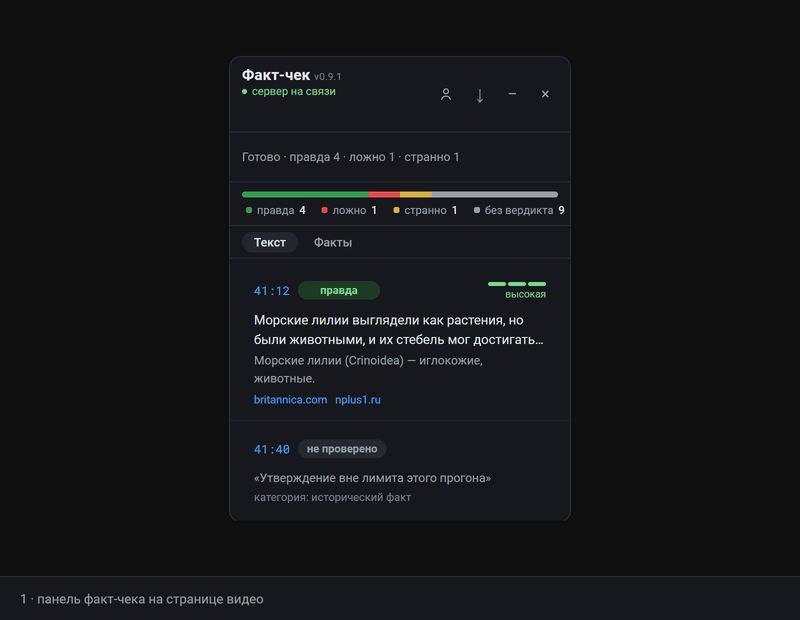

# video-factcheck

[](LICENSE)
[](backend/tests)

[RU](README.md) · [EN](README.en.md) · [中文](README.zh.md) · [Español](README.es.md) · **Français**

Une extension Chrome (MV3) qui vérifie les affirmations des vidéos YouTube pendant que vous les regardez. Elle lit les sous-titres directement depuis la page, le serveur en extrait les affirmations vérifiables avec leurs minutages, vérifie chacune —contre les vérifications humaines existantes, la recherche web et des articles scientifiques— et affiche les verdicts «vrai / faux / douteux» dans un panneau à côté du lecteur. Un clic sur le minutage saute au moment de la vidéo où l'affirmation a été prononcée ; chaque verdict s'accompagne d'une source avec une citation littérale.

«Douteux» est un verdict à part entière, pas une roue de secours : il marque les affirmations sur lesquelles deux passes de recherche web ont divergé ou pour lesquelles les sources ont manqué. La couche scientifique est volontairement prudente : un article ne fait bouger un verdict que s'il porte exactement sur le sujet et est assez récent, et il ne prononce jamais «faux» — au mieux il rétrograde «vrai» en «douteux».



## Comment ça marche

```text
[cascade de sous-titres]   les sous-titres sont lus depuis la page ; yt-dlp côté serveur sert de repli
        ↓
[extraction des affirmations]   faits vérifiables avec minutages ; les opinions partent en «non vérifiable»
        ↓
[vérification, trois couches en parallèle]
        ├─ ClaimReview — vérifications humaines existantes (Google Fact Check Tools)
        ├─ sonar × 2 — recherche web ; passes en désaccord → «douteux»
        └─ science — Europe PMC → OpenAlex, adjudication NLI sur les résumés
        ↓
[fusion du verdict]        conflit «vrai vs science-réfute» → «douteux»
        ↓
[panneau sur YouTube]      cartes avec minutages, sources et pondération de la source
```

- **Cascade de sous-titres.** Octobre 2026 : YouTube a fermé l'accès direct aux sous-titres, donc l'extension essaie les routes dans l'ordre — un pont depuis le monde de la page (captionTracks du lecteur vivant), `timed_text`, le panneau DOM «Transcription», l'endpoint `get_transcript` avec les cookies de la page. Si tout échoue, le serveur récupère les sous-titres via yt-dlp.
- **Affirmations.** Un LLM annote les segments de la transcription : citation littérale, catégorie, significativité. Opinions, prédictions et hyperbole partent en «non vérifiable» ; les doublons se replient par haché normalisé.
- **ClaimReview.** Si l'affirmation a déjà été vérifiée par des humains (PolitiFact, Snopes, AFP, Provereno.media), leur verdict s'affiche avec l'attribution du média — aucun appel de LLM. Ces cartes arrivent en premier, avant même la fin de l'extraction.
- **sonar × 2.** Chaque vérification passe deux fois par un modèle avec recherche web intégrée ; si les passes divergent, le résultat est «douteux». Une source n'est acceptée qu'avec une citation littérale ; les citations inventées sont filtrées.
- **Couche scientifique.** Europe PMC (médecine/biologie, sans clé) et OpenAlex (toute la science). Un modèle bon marché adjudique la relation entre le savoir établi et l'affirmation sur les 3 meilleurs résumés. Garde-fous d'influence : un article ne fait bouger un verdict que s'il porte exactement sur le sujet, date de 2015 au plus tôt (ou est une revue/méta-analyse) et s'appuie sur une citation littérale.
- **Fusion.** Un «vrai» contredit par la science est rétrogradé en «douteux», confiance «basse» et justification fusionnée. Dans l'autre sens, la science ne relève jamais un verdict.
- **Panneau.** Un flux de cartes avec filtre par verdict, une carte des verdicts sur la timeline de la vidéo, une échelle de confiance, et les sources avec leur pondération en surbrillance («science», «officiel»).

## Fonctionnalités

- Verdicts «vrai / faux / douteux» avec minutages et échelle de confiance ; un clic sur le minutage saute à ce moment de la vidéo
- Couche scientifique avec garde-fous de pertinence et de fraîcheur (Europe PMC → OpenAlex), adjudiquée sur les résumés avec citation littérale obligatoire
- Pondération des sources en surbrillance — «science», «officiel» — selon un registre de confiance des domaines
- Interface RU/EN ; la langue des justifications de verdicts se règle séparément de la langue de l'interface
- Historique des 50 dernières vidéos vérifiées — en local, dans votre navigateur
- Panneau transformable : se replie en pastille avec badge «terminé» et ne bouche pas l'écran pendant la vérification

## Installation depuis les sources

Il faut Chrome/Edge 111+ et Python 3.12+. L'extension n'est pas sur le Chrome Web Store — installation depuis les sources uniquement. Toutes les vérifications passent par votre propre serveur sur `127.0.0.1:8765`, avec vos propres clés API.

### Serveur

```bash
cd backend
python -m venv .venv
.venv/Scripts/pip install -r requirements.txt    # Linux/macOS : .venv/bin/pip
cd ..
cp .env.example .env
```

Renseignez vos clés dans `.env` :

- `VFC_LLM_KEY` — clé d'un fournisseur compatible OpenAI (bothub par défaut : deepseek extrait les affirmations et adjudique le NLI, sonar rend les verdicts avec recherche web de son côté). Obligatoire.
- `VFC_SERPER_KEY` — votre clé de recherche Serper pour le backend de recherche.
- `VFC_FACTCHECK_KEY` — clé Google Fact Check Tools ; sans elle, la couche ClaimReview est simplement ignorée.

Europe PMC et OpenAlex fonctionnent sans clé. Démarrage du serveur :

```bash
cd backend
.venv/Scripts/python -m videofactcheck.cli serve --port 8765
```

Sans Chrome, une vidéo isolée se vérifie depuis la CLI : `.venv/Scripts/python -m videofactcheck.cli check "<url de la vidéo>"`.

### Extension

1. Ouvrez `chrome://extensions` et activez le «Mode développeur».
2. «Charger l'extension non empaquetée» → le dossier `extension` de ce dépôt.
3. Ouvrez n'importe quelle vidéo YouTube — un panneau «Vérification» apparaît à droite. Cliquez sur «Vérifier la vidéo».

Les sous-titres arrivent en une dizaine de secondes, les affirmations en 2–4 minutes pour une vidéo de 15 minutes ; les verdicts arrivent au fil de leur disponibilité, inutile d'attendre : repliez le panneau, la vérification continue en arrière-plan.

## Architecture

```text
extension/                    Chrome MV3
  content.js                  panneau sur YouTube : cartes, carte des minutages, repli en pastille
  page-bridge.js              script dans le monde MAIN : captionTracks et videoDetails du lecteur vivant
  background.js               service worker : dialogue avec le serveur
  options.html, account.html  réglages (langue) et historique des 50 vidéos dans chrome.storage
backend/                      FastAPI + CLI
  videofactcheck/transcript.py       repli sous-titres côté serveur : yt-dlp, parseur VTT avec nettoyage des sous-titres auto
  videofactcheck/claims.py           extraction des affirmations avec minutages
  videofactcheck/factcheck_db.py     ClaimReview : vérifications humaines existantes
  videofactcheck/verdict.py          sonar × 2, échelle de confiance, fusion
  videofactcheck/plausibility.py     couche scientifique : Europe PMC → OpenAlex, NLI avec citation
  videofactcheck/trust.py            poids de confiance des domaines (whitelist/blacklist)
  videofactcheck/store.py            SQLite : passages, verdicts, transcriptions
  videofactcheck/server.py           API HTTP pour l'extension (127.0.0.1:8765)
  videofactcheck/cli.py              `serve` et `check <url>`
  tests/                             72 tests, pytest
```

L'extension envoie au serveur une transcription lue depuis la page (les requêtes vers YouTube partent de l'IP de l'utilisateur, pas de celle du serveur) et reçoit les verdicts au fur et à mesure.

## Statut

Projet personnel. Version 0.9.1 (octobre 2026), éprouvé sur des vidéos réelles.

Le projet a grandi par itérations au fil des retours de passages réels : la cascade de sous-titres est née quand YouTube a fermé l'accès direct en octobre 2026 ; le tapis ClaimReview (les vérifications humaines arrivent avec les premiers lots d'extraction) et la stratification des verdicts sur la timeline viennent de longs passages sur des interviews de 40 minutes ; le panneau repliable vient d'une seule plainte — «le panneau bouche l'écran».

Limites : les vidéos sans sous-titres sont refusées (la transcription automatique est prévue), les directs et les Shorts ne sont pas pris en charge, un passage rend au plus 15 verdicts — le reste est marqué «non vérifié».

## Licence

MIT, voir [LICENSE](LICENSE).
